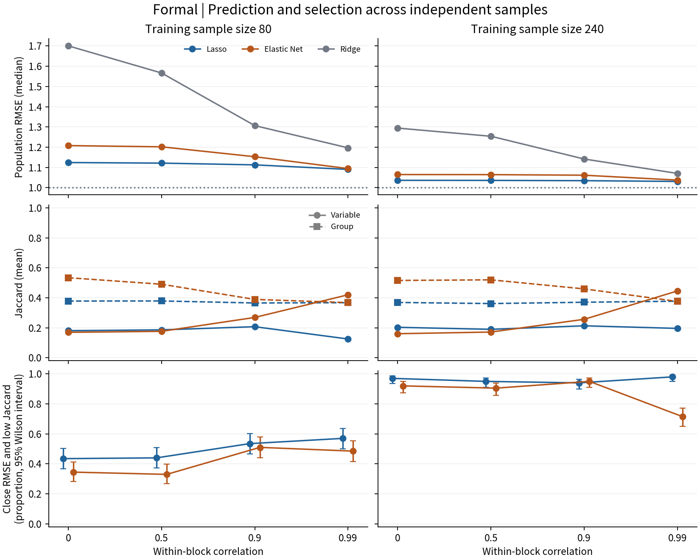
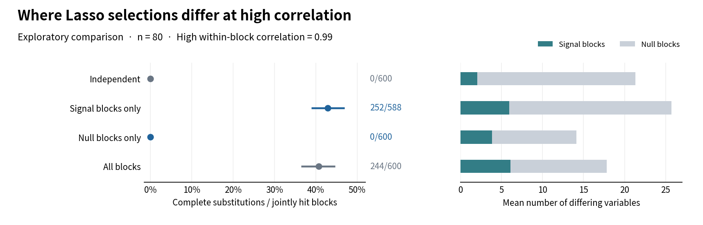

# How Stable Is Lasso Feature Selection When Prediction Errors Are Similar?

**Introduction.** Lasso is a regression method that can set some coefficients to zero, leaving a shorter list of variables in the model. Imagine using monthly repayment records to predict credit default. If two months contain similar information, a model trained on one sample might keep the first month, while a model trained on another sample might keep the second. Both could have nearly the same average prediction error. This raises a question for anyone interpreting the selected variables: would the same variables be selected if the model were trained again on new data?

**Question.** When two Lasso fits have similar average prediction errors, how much do their lists of selected variables overlap? When the lists differ, are the models using different variables from the same group of correlated predictors, or are they picking variables from groups that contain no underlying signal?

**Method.** We simulated 120 candidate predictors in 24 groups of five. By construction, only three predictors directly contributed to the outcome, one in each of three groups. We varied how strongly predictors within a group were correlated while keeping the strength of the signal and noise fixed. In each repetition, we drew two independent training samples and tuned Lasso and Elastic Net on each sample using five-fold cross-validation. We then compared prediction errors, the individual variables selected, and which of the three known signal groups each fit detected.

**Key Findings.** With 80 observations per training sample, we found the following.

1. **Similar prediction errors can hide very different variable lists.** Even when all predictors were independent, **87 of the 88 Lasso pairs with similar prediction errors** shared at most half of the variables selected by either fit. In this setting, similar average error gave little indication that the same variables would be selected after retraining.
2. **The two fits can agree on the group and pick different variables within it.** When the correlation between any two predictors in the same group was **0.99**, the five variables in each group tended to move almost in lockstep. In all 200 pairs, both fits selected at least one variable from each of the three signal groups. Yet in **244 of the 600 group comparisons**, the two fits selected entirely different members of the same group. This shows how Lasso can repeatedly find the group containing the signal while changing which variables it uses to represent it.
3. **Finding the right group can still leave the true predictor out.** In **42 of those 244 comparisons**, neither fit selected the variable that actually contributed to the simulated outcome. Both fits had selected correlated stand-ins, so agreement at the group level gave an incomplete picture of whether Lasso had recovered the variables used to generate the outcome.

---

## How do we define similar prediction errors in this study?

For the simulation, we call two fits “close” when their population root mean squared errors (RMSEs) differ by at most 0.05 times the noise standard deviation. The noise standard deviation is 1, so a gap of 0.05 meets the cutoff. We chose this tolerance before the pilot and also specified tighter (0.02) and looser (0.10) cutoffs to see how much the answer depends on that choice. We call variable overlap “low” when at most half the variables selected by either fit appear in both (Jaccard ≤ 0.50). [Original protocol](docs/protocol.md)

I asked to show both denominators side by side because they answer different questions. The table shows Lasso at training size 80. In the first row, 88 of 200 pairs had close errors. The same 87 pairs count toward both percentages, but only the last column answers the question in the title.

| Within-group correlation | Both events, out of all independent pairs | Low overlap, out of close-error pairs |
|---|---:|---:|
| 0 | 87/200 (43.5%) | 87/88 (98.9%) |
| 0.90 | 107/200 (53.5%) | 107/107 (100%) |
| 0.99 | 114/200 (57.0%) | 114/114 (100%) |

At training size 80, raising the correlation from 0 to 0.90 brought more pairs within the prediction cutoff. Among those pairs, low overlap was already common at zero correlation. At size 240, the joint rate went from 97.0% to 94.0% over the same range. In an exploratory check at size 80, tightening the *overlap* cutoff to 0.25 gave **76/200 and 75/200** joint events. The clearest change was in *which variables* the fits disagreed on. [Conditional distributions and denominators](docs/report.md#how-sensitive-is-low-overlap-to-its-definition)

*Figure 1.* Each point is a proportion of independent training pairs with a 95% Wilson interval. Rows separate the two training sizes. The lower panels show absolute prediction error and mean overlap at variable and group level. For Lasso at size 80, mean RMSE was 1.134 at independence and 1.097 at correlation 0.99, against an oracle value of 1. [Complete condition table, including the two original controls](results/formal/condition_summary.md)

## What explains the disagreement?

In the exploratory follow-up, **only signal groups** had correlation 0.99 in one condition and **only null groups** had that correlation in the other. Lasso completely changed its within-group members in **252/588** jointly detected signal groups in the first condition and **0/600** in the second. Yet 111/112 close-error pairs in the null-only condition still had low overall overlap. Four of 200 signal-only pairs failed the solver rule, leaving 196 valid pairs and 588 jointly detected signal groups. [Exploratory comparison and uncertainty](docs/report.md#exploratory-controls-at-correlation-099)

*Figure 2.* Blue marks are the two post-formal controls. Gray marks are the formal references. The counts on the left use signal groups jointly detected by both fits. The bars count differing variables across all 24 groups.

**Elastic Net selected more of the same variables, and more variables overall.** At training size 80 and correlation 0.99, mean variable Jaccard rose from 0.126 for Lasso to 0.420 for Elastic Net. The average list grew from 11.35 to 26.82 variables, including 9.50 and 23.84 false selections, respectively. Across all 1,999 valid pairs in the main simulation and its original controls, only one met the rule for comparing methods at similar size and predictive risk. Whether Elastic Net retains the advantage at equal model size remains open.

**What happened to the repayment months in the opening example?** On 6,000 held-out customers, L1 logistic regression achieved a mean log loss of 0.4442. Predicting the training sample’s default rate for everyone gave 0.5284. Every L1 fit used repayment status, yet the selected months differed in 85 of 100 training pairs. For this binary outcome, we set a separate log-loss tolerance of about 0.00393 using the pilot validation data. The customer records let us check predictions, but which months truly carry signal is unknown. [Pilot calibration](docs/pilot.md) · [Credit results and coding sensitivity](docs/report.md#credit-default-on-held-out-customers)

## Why we designed the study this way

**Why start with a simulation?** Lasso’s zero coefficients give us a list to interpret. On real credit records, we can see whether a month appears on that list, but we cannot check whether it belongs there. In the simulation we know the answer. Putting each true predictor in a separate, independent group keeps the signal variance at 3 as within-group correlation changes. This lets us make a stand-in more informative without making the overall signal stronger. [Tibshirani (1996), on Lasso](https://doi.org/10.1111/j.2517-6161.1996.tb02080.x) · [Design and derivation](docs/mechanism.md)

**Why retrain both methods?** Selection stability concerns how a variable list changes with the training data. We therefore drew fresh samples and tuned each fit from scratch. Within a sample, Lasso and Elastic Net used the same folds. Zou and Hastie showed that Elastic Net tends to keep correlated predictors together. That gives a reason to compare the two methods and to count how many extra variables that agreement brings in. [Nogueira, Sechidis and Brown (2018), on selection stability](https://www.jmlr.org/papers/v18/17-514.html) · [Zou and Hastie (2005), on the grouping effect](https://doi.org/10.1111/j.1467-9868.2005.00503.x)

**Why add two more controls?** In the original runs, complete substitutions jumped from 5 of 600 signal-group comparisons at correlation 0.90 to 244 of 600 at 0.99. Correlation had changed in all 24 groups at once. I asked for two follow-up runs at 0.99, one with correlation confined to the three signal groups and one with it confined to the other 21. That comparison let us trace the substitutions to their source. We report it as exploratory because the original results prompted the decision. [Follow-up plan](docs/exploratory-plan.md) · [Control results](docs/report.md#exploratory-controls-at-correlation-099)

## Report and supporting material

- [English research report](docs/report.md) — theory, simulation estimates, uncertainty, robustness and the credit application.
- [Design and discussion audit](docs/research-audit.md) — how each design choice answers the question, which alternative explanations survived, and the statistical and computational skills involved.
- [Original protocol](docs/protocol.md) · [Pilot review](docs/pilot.md) · [Frozen settings](config/frozen.json) · [Post-formal interpretation checks](docs/interpretation-checks.md).
- [Derivation and fitted-coefficient check](docs/mechanism.md) · [Computational verification](docs/review.md) · [Application CV wording](docs/cv-drafts.md).

## Reproduce

The pinned Python environment, commands from download through figures, archive-only rebuild and full refit are documented in the [reproduction guide](docs/reproduce.md). Credit data are from I-Cheng Yeh’s *Default of Credit Card Clients*, UCI Machine Learning Repository, DOI 10.24432/C55S3H, licensed under CC BY 4.0. The repository contains aggregate results and model fits. The original workbook and customer IDs are kept in the lab project. [UCI dataset](https://doi.org/10.24432/C55S3H) · [License](https://creativecommons.org/licenses/by/4.0/) · [Data audit and month mapping](results/pilot/credit_data_audit.json)
