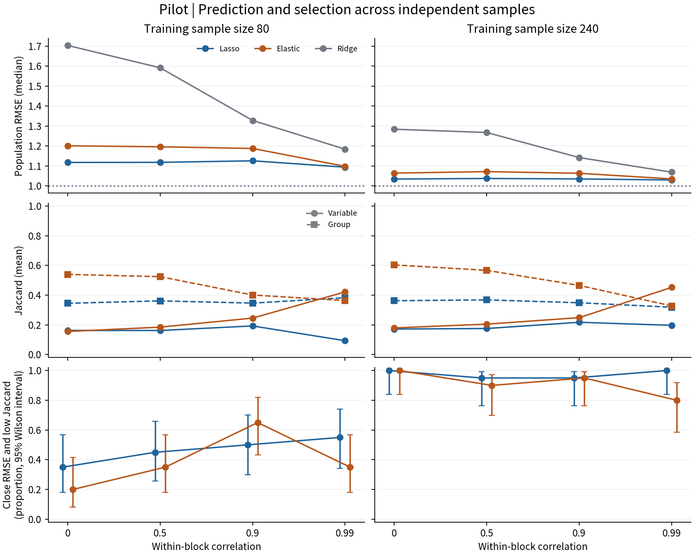
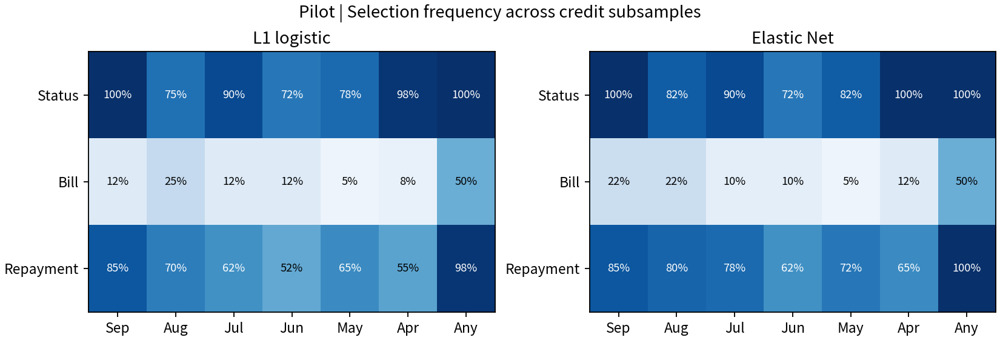

# Pilot review

These are calibration results from 20 independent training pairs per simulation condition. The credit results use a development validation set of 4,800 customers. The 6,000-customer final test set remains reserved.

## Prediction and selection

**Figure 1.** Columns give training sample size. The first row shows median population RMSE, with the oracle at one. The second shows mean support overlap at variable and group level. The third shows the proportion of independent pairs with an RMSE gap at most 0.05 and variable Jaccard at most 0.5. Error bars are 95% Wilson intervals. Correlation levels are displayed as ordered categories.

At n = 80, 7/20 independent-feature Lasso pairs met both criteria. At correlation 0.9 this rose to 10/20 and at 0.99 to 11/20. At n = 240 the corresponding counts were 20/20, 19/20 and 20/20. The near-ceiling event frequency at n = 240 limits the ability of this binary summary to distinguish correlations.

Among 60 jointly detected signal blocks at n = 80, Lasso changed all selected members in 1 block at correlation 0.9 and in 33 at correlation 0.99. At 0.99, mean variable Jaccard was 0.094 for Lasso and 0.422 for Elastic Net. Mean selected counts were 11.25 and 26.65 respectively. Mean true-variable recall was 0.558 and 1.000, with mean false inclusions of 9.58 and 23.65. These preliminary differences motivate inspecting size/risk-matched comparisons and independent replications.

Across all ten conditions, 400 training samples yielded 1,200 final linear fits. Neither sparse method selected a grid endpoint. Ridge selected its lowest grid value three times; keep this limitation visible in its baseline results. All 48 analytic checks used 100,000 independent tests per audited fit (tests shared across methods within a training sample). The largest absolute standardized discrepancy in MSE was 1.921. All model pairs were retained. The initial run took 66.5 seconds with two workers on the lab host.

## Credit development validation

**Figure 2.** Each cell shows the fraction of 40 fitted training subsamples selecting that month. The final column gives the frequency of selecting any month in that family. September through April refer to 2005. The same subsamples and validation customers are used across methods.

The median paired gain in log loss from the prevalence baseline to L1 was 0.07853256, giving a proposed close-loss threshold of 0.0039266281. Mean validation log loss was 0.528486 for the baseline, 0.450399 for L1 and 0.450042 for Elastic Net. Among 20 pairs, 18 L1 pairs had close loss and 10 satisfied both criteria. Status was selected in all 40 L1 fits; the chosen status months differed in 19/20 jointly hit pairs. Bills were selected in 20/40 fits. The highest within-family development Spearman correlation was 0.912 between September and August bills. Repayment status used one column per month with nonpositive codes collapsed to zero.

The original workbook contains 30,000 unique customers. The audit supplies field mapping, target frequencies, special status codes, file hashes and split sizes. Both logistic methods had zero grid endpoints. Six path-point optimizations required a second attempt; all passed the stated first-order tolerance (maximum residual 0.00000307). The initial credit run took 26.5 seconds with two workers.

## Decision before formal evaluation

Retain the predeclared 0.05 simulation gap and 0.5 variable-overlap cut; report continuous metrics and the actual close-event denominators. The target of 200 pairs per condition is feasible. At a proportion of 0.5 this yields Monte Carlo SE 0.0354; the pilot SE is 0.112. Proposed credit evaluation uses 100 disjoint-within-pair draws with the development-derived threshold above. Junyang's configuration review and final authorization are pending.
