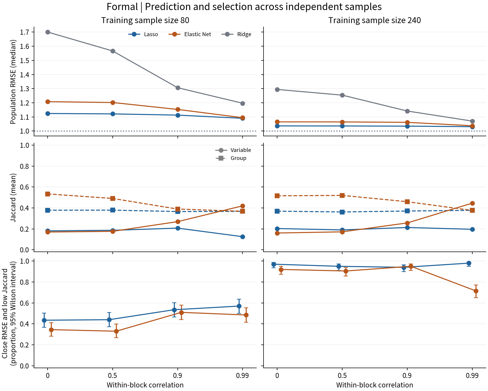
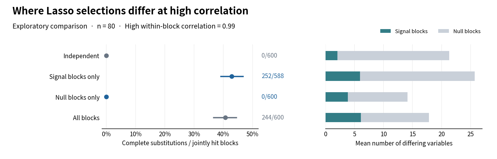
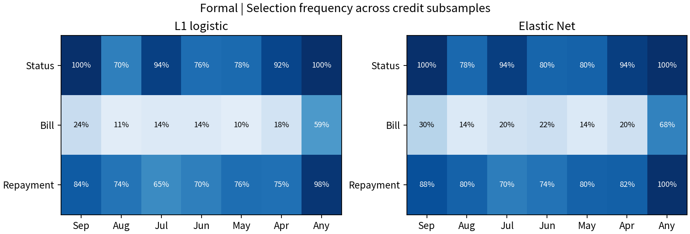

# How Stable Is Lasso Feature Selection When Prediction Errors Are Similar?

**A paired-sample simulation and a credit-default application.** Low variable overlap was common even with independent features. Near-collinear signals changed *why* the models disagreed. At training size 80, Lasso substituted disjoint sets of predictors in 5 of 600 jointly detected signal blocks at correlation 0.9 and 244 of 600 at 0.99. Elastic Net recovered more true predictors in the latter condition and selected substantially larger models.

## Design and estimands

We generated 120 standardized Gaussian predictors in 24 independent blocks of five. The middle variable of each of three blocks had coefficient one. Noise was independent with SD one. The three signal variables are independent, so signal variance is three at every within-block correlation. Population RMSE is one for the true regression function and two for the predictor that always returns zero.

Each condition had a target of 200 independent training pairs. Each sample received its own five-fold CV, with fold-trained standardization and validation MSE. Lasso, Elastic Net (L1 fraction 0.5) and the Ridge prediction baseline shared samples and folds. After transforming slopes and intercepts back to the generating scale, we evaluated population MSE as $1+\hat a^2+(\hat\beta-\beta)^T\Sigma(\hat\beta-\beta)$. The primary event required an RMSE gap of at most 0.05 and variable Jaccard at most 0.5. We also retained both marginal probabilities, low overlap conditional on close RMSE, group Jaccard, model size and truth recovery. Wilson intervals use independent sample pairs. Method contrasts and within-block swap intervals resample whole pairs. Pilot fits were excluded from formal estimates. [Protocol](protocol.md) · [Frozen settings](../config/frozen.json)

For standardized $X_1,X_2$ with correlation $\rho$, replacing $bX_1$ by $bX_2$ adds

$$
\mathbb E[(bX_1-bX_2)^2]=b^2(1+1-2\rho)=2b^2(1-\rho)
$$

to population MSE, since the independent noise cross-term has expectation zero. At $b=1$ and $\rho=0.99$, total RMSE rises from 1 to about 1.010. This calculation holds the slope fixed. The experiment measures how often separately tuned finite-sample fits actually substitute variables, while allowing changes in slopes, intercepts and noise selections. [Derivation](mechanism.md)

## Correlation changes the source of disagreement

**Figure 1.** Each dot and interval estimates a proportion across independent training pairs (95% Wilson interval). The joint column divides the number of close-error, low-overlap pairs by all valid pairs. The conditional column divides the same numerator by the number with close error. The count beside each dot gives its exact numerator and denominator. Rows separate training samples of size 80 and 240. The bottom panels give median population RMSE and mean variable and group Jaccard. [Full condition table](../results/formal/condition_summary.md)

At $n=80$, the Lasso joint event occurred in 87/200, 88/200, 107/200 and 114/200 pairs at correlations 0, 0.5, 0.9 and 0.99. The prespecified 0.9-minus-0 contrast was **+10.0 percentage points** (95% interval +0.2 to +19.5). Among pairs with close RMSE, low overlap occurred in 87/88 at zero correlation and 107/107 at 0.9. The change in joint frequency therefore mainly tracked how often the RMSEs were close. At $n=240$ the four joint counts were 194, 190, 188 and 196 out of 200. The prespecified contrast was **−3.0 points** (−7.5 to +1.2). The binary event was near its ceiling. Shrinking the RMSE tolerance to 0.02 yielded 123/200 versus 116/200 at 0 and 0.9 in this larger sample. [Endpoint contrasts](../results/formal/main/endpoint_contrasts.csv) · [Threshold sensitivities](../results/formal/main/thresholds.csv)

At $n=80$, mean Lasso RMSE improved from 1.134 at independence to 1.097 at 0.99. Mean Ridge RMSE changed from 1.707 to 1.210. Even among the close-risk Lasso pairs at 0.99, the median root-mean-square difference between the two predictions **on the same new subject** was 0.455, in response units. Similar average errors can coexist with materially different individual predictions. [Continuous outcomes](../results/formal/main/conditions.csv) · [Prediction disagreement](../results/formal/mechanisms.csv)

| Lasso at $n=80$ | Joint event | Complete swaps / jointly hit signal blocks | Mean differing variables, signal / null blocks |
|---|---:|---:|---:|
| All blocks independent | 87/200 | 0/600 | 2.04 / 19.28 |
| Only signal blocks at 0.9 | 74/199 | 4/597 | 4.39 / 18.57 |
| Only null blocks at 0.9 | 95/200 | 0/600 | 3.22 / 12.56 |
| All blocks at 0.9 | 107/200 | 5/600 | 4.67 / 13.30 |
| All blocks at 0.99 | 114/200 | 244/600 | 6.09 / 11.73 |

When both fits hit a signal block, a complete swap means their selected members have empty intersection. The selective-correlation controls show why low Jaccard alone has limited diagnostic value. At independence, most disagreements came from null blocks. At 0.99, 40.7% of jointly hit signal blocks underwent a complete swap (pair-bootstrap interval 36.5–44.7%). A further 302/600 had partially overlapping memberships. Four of the 54 identical memberships contained only proxy variables. All three signal groups were jointly detected in every pair at 0.99, yet whole-model mean group Jaccard was only 0.368 because null groups also entered. At $n=240$, the complete-swap rate at 0.99 fell to 65/600 (10.8%). [Block counts](../results/formal/mechanisms.csv) · [Per-variable selection frequencies](../results/formal/main/variable_frequencies.csv)

**A worked example of stable proxy selection.** In formal pair 19 (zero-based ID), at $n=80$ and $\rho=0.99$, the two Lasso population RMSEs were 1.09977 and 1.07735. Their gap of 0.02242 met the frozen 0.05 criterion. In the second signal block both fits selected only $X_9$, while the generating coefficient was one for $X_8$ and zero for $X_9$. The pair therefore agreed on the selected member and missed the true member. Across all 120 variables its Jaccard was 0.20. This post-run illustration is the first qualifying pair by archived ID with close RMSE and a shared proxy-only block. The 4/54 count above gives the frequency among identical, jointly nonempty block memberships in this condition. [Verification record](../results/formal/full_refit.json)

## Elastic Net and robustness

At $n=80,\rho=0.99$, mean variable Jaccard was **0.126 for Lasso and 0.420 for Elastic Net**. The paired increase was 0.295 (95% bootstrap interval 0.279–0.311). Mean RMSEs were 1.097 and 1.104, mean sizes 11.35 and 26.82, true-variable recalls 61.75% and 99.25%, and mean false inclusions 9.50 and 23.84. At independence, Elastic Net had slightly lower variable Jaccard. Across the ten conditions only one of 1,999 pairs satisfied the prespecified requirement for similar cross-method RMSE and model size on **both** samples. The data provide too little overlap to estimate a stability advantage at comparable sparsity. [Paired method comparisons](../results/formal/main/method_differences.csv) · [Elastic Net grouping effect](https://doi.org/10.1111/j.1467-9868.2005.00503.x)

| Prespecified check at $n=80$ | Lasso result | Interpretation |
|---|---|---|
| Independent seeds, 0 versus 0.9 | 84/200 versus 101/200 joint events. Difference +8.5 points (−1.3 to +18.0) | The direction repeated, with uncertainty spanning zero. |
| Independent-pilot fixed penalties | 96/200 versus 118/200 joint events. At 0.99 there were 236/600 complete swaps. | The main direction and near-collinear swaps persisted with tuning variability removed within each condition. |
| AR(1) blocks with mean correlation 0.9 | Adjacent correlation 0.9480. Joint events 107/200, complete swaps 23/600. Equicorrelated blocks gave 107/200 and 5/600. | Holding the average correlation fixed preserved the event count here, while the position-dependent correlation structure changed substitution frequency. |

The original selective-correlation controls used 0.9. A subsequent exploratory experiment at 0.99 is reported separately below. Conclusions concern this sparse Gaussian signal, CV rule and mixing fraction. [Independent replication](../results/formal/replication/endpoint_contrasts.csv) · [Fixed penalties](../results/formal/fixed/conditions.csv) · [AR(1) results](../results/formal/ar/conditions.csv)

## Exploratory controls at correlation 0.99

After observing 244 complete Lasso substitutions in the all-correlated formal condition, we asked whether strong within-block correlation in the three signal blocks could account for frequent substitutions when the 21 null blocks were independent. We recorded the two controls before fitting them. Both used training size 80, fresh training pairs, the original tuning procedure and the original decision rules. Each high-correlation block had within-block correlation 0.99. Blocks remained mutually independent. [Exploratory plan](exploratory-plan.md) · [Configuration](../config/exploratory-rho099.json)

| Blocks with high within-block correlation | Source | Close error and low overlap / valid pairs | Low overlap / close-error pairs | Complete swaps / jointly detected signal blocks |
|---|---|---:|---:|---:|
| None | Formal reference | 87/200 | 87/88 | 0/600 (0%) |
| Signal blocks only | Exploratory | 89/196 | 89/89 | 252/588 (42.9%) |
| Null blocks only | Exploratory | 111/200 | 111/112 | 0/600 (0%) |
| All blocks | Formal reference | 114/200 | 114/114 | 244/600 (40.7%) |

**Lasso made frequent complete substitutions when strong correlation was confined to signal blocks.** The signal-only rate exceeded the all-blocks estimate by 2.2 percentage points (95% pair-bootstrap interval −3.6 to +7.9). The interval allows differences in both directions, and the design specified no equivalence margin. The signal-only minus null-only difference was 42.9 points (+38.8 to +47.1). The intervals use 5,000 independent resamples of training pairs within each condition, keeping a pair’s three signal blocks together. [Four-cell results and event intervals](../results/exploratory/rho099/four_cells.csv) · [Swap-rate contrasts](../results/exploratory/rho099/swap_contrasts.csv)

The aggregate stability measures tell a different part of the story. With only null blocks highly correlated, 111 of the 112 close-error pairs still had low variable overlap, despite zero complete signal-block swaps. Their supports differed on an average of 3.83 variables from signal blocks and 10.29 from null blocks. With only signal blocks highly correlated, those counts were 5.92 and 19.79. Elastic Net had zero complete swaps in both new controls. In the signal-only condition it selected 30.23 variables on average, versus 16.00 for Lasso, and averaged 27.23 false inclusions versus 14.22. [Method and mechanism estimates](../results/exploratory/rho099/four_cells.csv)

**Figure 2.** Blue points identify the two exploratory controls and gray points the formal references. The left panel shows complete substitutions among signal blocks detected by both fits, with pair-bootstrap 95% intervals and exact counts. For cells with zero observed swaps, resampling the observed pairs also gives zero at both interval endpoints. The right panel counts predictors selected in exactly one fit and separates them by signal-block or null-block membership.

We attempted 200 pairs in each new control. Four signal-only pairs failed the Lasso convergence rule after its specified retry. Estimates for every method use the 196 common valid pairs in that condition. All 200 null-only pairs were valid. As an exploratory missing-outcome check, the four failed pairs contribute at most 12 additional signal-block opportunities. Assigning all 12 as jointly detected with zero or 12 swaps gives the extremes of 252/600 and 264/600 (42.0–44.0%) for this set of attempted pairs. This range describes the effect of missing outcomes in these runs. The bootstrap interval above measures sampling uncertainty. [Failure ledger](../results/exploratory/rho099/run.json) · [Independent metric audit](../results/exploratory/rho099/audit.json)

A second run from the recorded seeds reproduced the failure ledger, fit archive and all other exploratory outputs byte for byte. The formal figure was separately checked against the training-pair counts for both sparse methods in all eight formal conditions. [Verification record](../results/exploratory/rho099/verification.json)

## Credit default on held-out customers

Twenty-four thousand customers formed the development pool and 6,000 formed the fixed stratified test set. Every pair used two disjoint, stratified training subsamples of 3,000 customers. Different pairs could reuse customers. Eighteen predictors covered six months of bills, repayment amounts and status. The main encoding collapsed nonpositive status codes to zero and modeled positive grades linearly on log odds. The workbook includes −2 and 0, whose meanings the official dictionary leaves unspecified. The development-only pilot fixed the close-log-loss threshold at 0.0039266281 before test evaluation. September and August bills had development Spearman correlation 0.912. [Official dataset and dictionary](https://doi.org/10.24432/C55S3H) · [Audit and column mapping](../results/pilot/credit_data_audit.json)

| Model | Mean test log loss | Mean Brier score | Mean size | Mean variable / group Jaccard | Joint events / close pairs |
|---|---:|---:|---:|---:|---:|
| Training prevalence | 0.52838 | 0.17225 | 0 | — | — |
| L1 logistic | 0.44424 | 0.13800 | 10.42 | 0.589 / 0.813 | 19/87 |
| Elastic Net logistic | 0.44398 | 0.13797 | 11.21 | 0.632 / 0.843 | 9/86 |

**Figure 3.** Cells give selection frequencies across 200 fits. “Any” means at least one month in that family. Both methods included some repayment-status information in every fit. The status months changed in 85/100 L1 pairs and 78/100 Elastic Net pairs. Bills entered 59% of L1 fits. With raw numeric status codes, L1 mean log loss worsened to 0.46653, bill inclusion rose to 98%, and mean group Jaccard rose to 0.977. This coding sensitivity illustrates how a three-group overlap measure approaches one when nearly every group enters. Shared customers and a common test set make these descriptive comparisons within this dataset. The default label permits predictive evaluation. Variable-selection truth is available only in the simulation. [Credit results and coding sensitivity](../results/formal/credit_models.csv)

## Verification and limitations

One Lasso path in the signal-only correlation control failed the frozen convergence rule after its retry. That condition uses 199 common valid pairs for every method. All other stages accounted for their full planned samples. None of the main sparse-model pairs was double-empty. Independent blockwise calculations reproduced all formal primary counts and RMSEs, and independent scoring reproduced the credit test losses and Brier scores. A full refit from seeds reproduced all 4,799 valid formal stage-pair records and the one failed pair. All six fit archives, as well as 50 rebuilt result files, matched the original bytes. Repeating the pilots also regenerated the approved configuration exactly. [Full-refit evidence](../results/formal/full_refit.json) [Failure ledger](../results/formal/main/run.json) · [Metric audit](../results/formal/metric_audit.json) · [Earlier 404-pair replay](../results/formal/replay.json)

Across the 48 prespecified checks against 100,000 test observations, the largest absolute MSE discrepancy was 3.73 Monte Carlo standard errors (Ridge, $n=80$, independent features). An **exploratory numerical check** on that same fit used a different Gaussian generator and one million fresh observations. It gave MSE 2.7168 versus analytic MSE 2.7217, a difference of −1.28 standard errors. Both checks are retained. [Original checks](../results/formal/main/analytic_checks.csv) · [Exploratory check](../results/formal/exploratory_mse_check.json)
